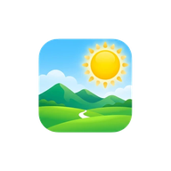

<h1 align="center">Simon-Galleria</h1>

  

ਯਾਦਾਂ ਨੂੰ ਆਜ਼ਾਦ ਕਰੋ, ਨਿੱਜੀ ਡੇਟਾ ਨੂੰ ਨਹੀਂ। Simon-Galleria ਇੱਕ ਬੇਹਤਰੀਨ ਫੋਟੋ ਅਤੇ ਵੀਡੀਓ ਐਪ ਹੈ ਜੋ ਜਿੰਨੀ ਸ਼ਕਤੀਸ਼ਾਲੀ ਹੈ ਓਨੀ ਹੀ ਨਿੱਜੀ ਵੀ। ਕੋਈ ਇਸ਼ਤਿਹਾਰ ਨਹੀਂ, ਕੋਈ ਗੈਰ-ਜ਼ਰੂਰੀ ਇਜਾਜ਼ਤਾਂ ਨਹੀਂ – ਸਿਰਫ਼ ਤੁਹਾਡੇ ਲਈ ਤਿਆਰ ਇੱਕ ਸਹਿਜ ਅਨੁਭਵ।

**🖼️ ਫੋਟੋ ਸੋਧ ਤੁਹਾਡੀਆਂ ਉਂਗਲਾਂ 'ਤੇ:**  
ਸਾਡੇ ਸਧਾਰਨ ਪਰ ਸ਼ਕਤੀਸ਼ਾਲੀ ਫੋਟੋ ਐਡੀਟਰ ਨਾਲ ਆਪਣੀਆਂ ਫੋਟੋਆਂ ਨੂੰ ਬਿਹਤਰ ਬਣਾਓ। ਕ੍ਰੌਪ, ਆਕਾਰ ਬਦਲੋ, ਘੁਮਾਓ, ਫਲਿਪ ਕਰੋ, ਖਿੱਚੋ ਅਤੇ ਸ਼ਾਨਦਾਰ ਫਿਲਟਰ ਲਗਾਓ – ਸਭ ਤੁਹਾਡੀ ਪਰਦੇਦਾਰੀ ਨਾਲ ਸਮਝੌਤਾ ਕੀਤੇ ਬਿਨਾਂ। ਆਪਣੀਆਂ ਯਾਦਾਂ 'ਤੇ ਪਹਿਲਾਂ ਕਦੇ ਨਾ ਹੋਇਆ ਕੰਟਰੋਲ ਲਓ।

**🌐 ਪਰਦੇਦਾਰੀ ਪਹਿਲਾਂ, ਹਮੇਸ਼ਾ:**  
ਤੁਹਾਡੀ ਪਰਦੇਦਾਰੀ ਮਾਅਨੇ ਰੱਖਦੀ ਹੈ। ਡੇਟਾ ਖਾਣ ਵਾਲੇ ਵੱਡੇ ਕਾਰੋਬਾਰਾਂ ਨੂੰ ਛੱਡੋ। Simon-Galleria ਤੁਹਾਨੂੰ ਕੰਟਰੋਲ ਵਿੱਚ ਰੱਖਦਾ ਹੈ। GPS ਕੋਆਰਡੀਨੇਟ ਅਤੇ ਕੈਮਰਾ ਵੇਰਵਿਆਂ ਵਰਗੀ EXIF ਮੈਟਾਡੇਟਾ ਹਟਾਓ, ਤੁਹਾਡੀਆਂ ਯਾਦਾਂ ਸਿਰਫ਼ ਤੁਹਾਡੀਆਂ ਹੀ ਰਹਿੰਦੀਆਂ ਹਨ।

**🔒 ਵਧੀਆ ਸੁਰੱਖਿਆ:**  
PIN, ਪੈਟਰਨ ਜਾਂ ਫਿੰਗਰਪ੍ਰਿੰਟ ਸੁਰੱਖਿਆ ਨਾਲ ਆਪਣੀਆਂ ਯਾਦਾਂ ਨੂੰ ਲਾਕ ਕਰੋ। ਖਾਸ ਫੋਟੋਆਂ, ਵੀਡੀਓ ਜਾਂ ਪੂਰੀ ਐਪ ਨੂੰ ਸੁਰੱਖਿਅਤ ਕਰੋ – ਕੌਣ ਪਹੁੰਚ ਪਾਵੇਗਾ ਇਹ ਤੁਸੀਂ ਤੈਅ ਕਰਦੇ ਹੋ। ਮਨ ਦੀ ਸ਼ਾਂਤੀ, ਗਾਰੰਟੀ।

**🔄 ਆਸਾਨੀ ਨਾਲ ਮੁੜ ਪ੍ਰਾਪਤ ਕਰੋ:**  
ਨਿਸ਼ਚਿੰਤ ਰਹੋ, ਹਾਦਸੇ ਹੁੰਦੇ ਹਨ! Simon-Galleria ਦੀ ਬਿਲਟ-ਇਨ ਰੀਸਾਈਕਲ ਬਿਨ ਤੁਹਾਨੂੰ ਮਿਟਾਈਆਂ ਫੋਟੋਆਂ ਅਤੇ ਵੀਡੀਓ ਸਕਿੰਟਾਂ ਵਿੱਚ ਮੁੜ ਪ੍ਰਾਪਤ ਕਰਨ ਦਿੰਦੀ ਹੈ। ਹੁਣ ਕੋਈ ਗੁੰਮਿਆ ਖਜ਼ਾਨਾ ਨਹੀਂ, ਸਿਰਫ਼ ਸ਼ੁੱਧ ਰਾਹਤ।

**🎨 ਤੁਹਾਡੀ ਗੈਲਰੀ, ਤੁਹਾਡਾ ਸਟਾਈਲ:**  
ਆਪਣੇ ਸਟਾਈਲ ਨਾਲ ਮੇਲ ਖਾਂਦੀ ਦਿੱਖ, ਅਹਿਸਾਸ ਅਤੇ ਕਾਰਜਸ਼ੀਲਤਾ ਨੂੰ ਅਨੁਕੂਲ ਬਣਾਓ। UI ਥੀਮਾਂ ਤੋਂ ਲੈ ਕੇ ਫੰਕਸ਼ਨ ਬਟਨਾਂ ਤੱਕ, Simon-Galleria ਤੁਹਾਨੂੰ ਉਹ ਰਚਨਾਤਮਕ ਆਜ਼ਾਦੀ ਦਿੰਦੀ ਹੈ ਜੋ ਤੁਸੀਂ ਚਾਹੁੰਦੇ ਹੋ।

**📷 ਵਿਸ਼ਵਵਿਆਪੀ ਫਾਰਮੈਟ ਆਜ਼ਾਦੀ:**  
JPEG, JPEG XL, PNG, MP4, MKV, RAW, SVG, GIF, AVIF, ਵੀਡੀਓ ਅਤੇ ਹੋਰ – ਤੁਹਾਡੀਆਂ ਯਾਦਾਂ ਤੁਹਾਡੇ ਚੁਣੇ ਕਿਸੇ ਵੀ ਫਾਰਮੈਟ ਵਿੱਚ ਕਵਰ ਹਨ। ਕੋਈ ਪਾਬੰਦੀ ਨਹੀਂ, ਸਿਰਫ਼ ਅਸੀਮ ਸੰਭਾਵਨਾਵਾਂ।

**✨ ਗਤੀਸ਼ੀਲ ਥੀਮਾਂ ਨਾਲ material design:**  
ਗਤੀਸ਼ੀਲ ਥੀਮਾਂ ਨਾਲ ਸਹਿਜ material design ਦੀ ਸੁੰਦਰਤਾ ਦਾ ਅਨੁਭਵ ਕਰੋ। ਹੋਰ ਚਾਹੀਦਾ ਹੈ? ਕਸਟਮ ਥੀਮਾਂ ਵਿੱਚ ਡੁੱਬੋ ਅਤੇ ਆਪਣੀ ਗੈਲਰੀ ਨੂੰ ਸੱਚਮੁੱਚ ਵਿਲੱਖਣ ਬਣਾਓ।
